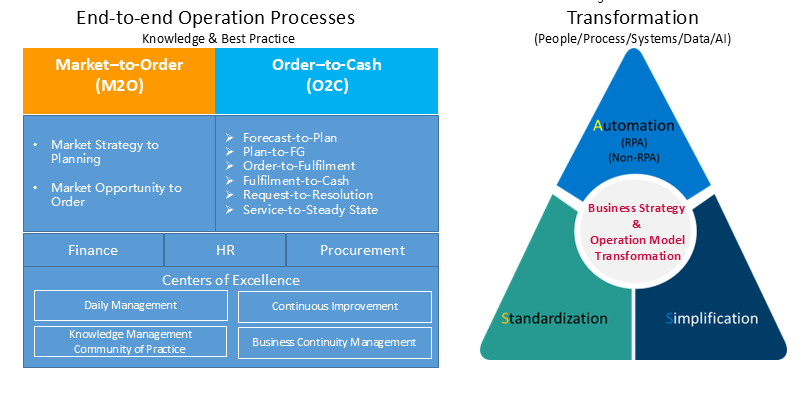

# Sandor Wang

**Suzhou, China. Twenty-five years turning enterprise process into systems — now building the harness that enterprise AI has to run inside.**

Enterprise AI does not fail on models. It fails on the harness.

I spent 25 years where process is not optional: food, medical imaging, medical devices, automotive, industrial automation, lighting, robotics — global SAP rollouts, shared-services transitions, and the PMO that has to hold the timeline, the deliverables and the risk. Then AI arrived, and I stopped talking about it and started building.

★ **[sdr010-coder.github.io](https://sdr010-coder.github.io)** — the site. **[enterprise-harness](https://github.com/sdr010-coder/EnterpriseHARNESS)** — the work.

---

## The framing I work from

```
Agent       =  Models + Harness

Enterprise  =  Agentic BPM
            ×  Agentic Organization
            ×  Agent Platform
            ×  Enterprise Harness
```

The first line is additive: one agent is a model plus a harness. The second is **multiplicative** — the four dimensions are not a menu, and any one of them at zero makes the whole zero.

| Dimension | What it is |
|---|---|
| **Agentic BPM** | the work — the process becomes the host, and the agent its citizen |
| **Agentic Organization** | the accountability — named roles, real decisions, who carries the consequence |
| **Agent Platform** | the capability — runtime, tools, memory, models that can be swapped |
| **Enterprise Harness** | the proof — gates that close, ledgers that reconcile, evidence a third party can check |

And inside the harness:

```
Enterprise Harness = Harness + Mandate + Ledger
```

- **Mandate** — a named human authorises a specific version, on a specific basis, and owns the consequence.
- **Ledger** — two of them: what happened, and what can be proven. Reconciled, so "it ran" and "it can be evidenced" are separate, checkable claims.

Read the definition: [What an Enterprise Harness is](https://github.com/sdr010-coder/EnterpriseHARNESS/blob/main/docs/02-what-is-enterprise-harness.md) — one sentence, and the line against a platform, a framework and a runtime.

---

## Shipped

| | |
|---|---|
| **Now** | **Enterprise Harness** — open definition, eleven documents, and a runnable reference implementation: named-signer mandate, six fail-closed gates, dual ledger with a hash chain. [repo →](https://github.com/sdr010-coder/EnterpriseHARNESS) |
| **2026** | **Agent-governance proof of concept** — built in 2 weeks: 475 processes, an 8-step delivery journey, 6 gates, a dual ledger and hash chain. Agents that can be approved, stopped and audited. |
| **2026** | **Evidence-first AI research platform** — every conclusion traces to a source, counter-evidence is a required field, and a human signs the result. 106 evidence items from 58 sources. |
| **2025–26** | **PMO platform for a global SAP S/4HANA rollout** — as PMO, I designed and built the implementation's platform, zero to live in 4.5 months. 56 pages, 51 tables, 119,000 lines, a 455-item category dictionary and 1,485 processes underneath. |
| **2024–26** | Transformation programme manager, APAC — a US food company. |
| **2019–24** | IT business partner — a global medical-device maker. |
| **Before** | Twenty years of enterprise systems across seven industries; teams up to 19; a nine-country shared-services transition; a first-in-group China SAP go-live. |

---

## Proof, in numbers

```
25+    years in regulated, multi-plant, multi-country operating environments
9      companies · 7 industries
4.5    months — a PMO platform, zero to live
56     business pages · 51 tables · 119,000 lines
1,485  processes · 4,759 process facts    (the PMO platform)
455    category standards · L1 6 / L2 61 / L3 388
2      weeks — agent governance, proof of concept
475    processes · 8-step journey · 6 gates · dual ledger   (that PoC)
83     tests in the reference implementation · Python 3.11+ · stdlib only
90     days — the validation window I will commit to
```

On the 119,000 lines: as PMO I designed and built that platform with AI coding, and I say so plainly. The AI did most of the typing. I owned the process model, the definitions, the category dictionary, the trade-offs and the acceptance. A number that large is only a claim about capacity if you say who did what.

---

## Three things I actually believe

**The model is rented; the harness is yours.**
Models get swapped every few months. Your context, your process, your gates and your evidence do not get to be swapped. Anything worth building is built on the layer that survives the swap.

**An agent without a process is a demo.**
AI that does not enter a process — with an owner, a budget and a gate — creates no value. It creates a screenshot.

**If it cannot be replicated, it is not a capability.**
Templates, training and reusable agent assets are the deliverable. One hero project is an anecdote.

---

## How I start

One enterprise, one value stream, ninety days.

**1 value stream · 1 group-level project · 3 digital employees · 1 human gate · 1 executive weekly report.**
Day 1 select the stream and set the baseline · Day 30 a thin working demo on real data · Day 60 close the loop · Day 90 it goes into a management review meeting once — and the answer is yes or no.

I publish my own stop rule, because a plan without one is a sales pitch: **if the 30-day check fails, we shrink the scope, change the approach, or stop.** No new platform budget, no second value stream, no promise of ROI I cannot measure yet.

---

## Before this

Twenty-five years, in order: hospitality IT, consulting, digital imaging, personal care, automotive, food manufacturing, lighting, robotics, medical devices, industrial automation. Shared-services centres, SAP in China and across Asia-Pacific, plants under FDA-SSOP, GMP and HACCP, and a lot of PMO.



<sub>The work behind the timeline, generalised: the end-to-end processes (market-to-order, order-to-cash) and the transformation shape they add up to — standardise, simplify, then automate.</sub>

I am not a pharma scientist and I do not pretend to be. My ground is where process, data, accountability and systems meet — and increasingly, where agents have to cross that ground without breaking it.

---

## Now

Open to **AI transformation and PMO leadership roles**, and to conversations with teams building enterprise agent platforms who need the governance layer to be real rather than described.

If you are hiring for the person who makes agents signable inside a regulated business, that is the job I am looking for.

**Contact:** [sdr010-coder.github.io](https://sdr010-coder.github.io) · open an issue on the [Enterprise Harness repo](https://github.com/sdr010-coder/EnterpriseHARNESS/issues)

<sub>Every number above is one I can defend. No badges, no counters, no dashboards.</sub>

---

## 中文

**Sandor Wang · 苏州**

25 年企业流程与系统，现在做企业 AI 必须跑在里面的那一层 —— Enterprise Harness。

企业 AI 不会死在模型上，会死在 Harness 上。

**我用的框架**

```
Agent  =  模型 + Harness

企业   =  Agentic BPM
        ×  Agentic Organization
        ×  Agent Platform
        ×  Enterprise Harness
```

第一行是加法；第二行是**乘法** —— 四个维度不是菜单，任何一项为零，整个就是零。

| 维度 | 是什么 |
|---|---|
| **Agentic BPM** | 事 —— 流程成为宿主，Agent 成为流程里的公民 |
| **Agentic Organization** | 责 —— 具名的角色、真实的决策、谁承担后果 |
| **Agent Platform** | 力 —— 运行时、工具、记忆、可以随时替换的模型 |
| **Enterprise Harness** | 证 —— 关得上的门、对得上的账、第三方能核的证据 |

Harness 里面：

```
Enterprise Harness = Harness + Mandate + Ledger
```

- **Mandate（授权）**：由具名的人，对确定的版本、在确定依据下授权，并承担后果。
- **Ledger（账本）**：两本 —— 一本记"发生了什么"，一本记"能被证明什么"，且定期对账。

**做过的事**

| | |
|---|---|
| **现在** | Enterprise Harness 开源参考实现：具名签署人、6 道 fail-closed 门、双账本 + 哈希链，83 个测试 |
| **2026** | Agent 治理 PoC，2 周：475 条流程 / 8 步旅程 / 6 道门 / 双账本 —— 能批、能停、能审计 |
| **2026** | 证据优先的 AI 研究平台：每条结论可回溯来源，反证是必填项，最终由人签字 |
| **2025–26** | 全球 SAP S/4HANA 上线的 PMO 平台：以 PMO 身份设计并建设该项目的平台，4.5 个月从 0 到上线，56 页面 / 51 表 / 11.9 万行 / 455 条分类标准 / 1,485 条流程 |
| **2024–26** | APAC 转型项目经理（美资食品公司） |
| **2019–24** | IT 业务伙伴（全球医疗器械公司） |
| **更早** | 二十五年企业系统，横跨七个行业；带过 19 人团队；做过九国共享服务转移；做过集团内第一个中国 SAP 上线 |

**三句话**

- **模型是租来的，Harness 是自己的。**
- **AI 不进流程，就没有价值。**
- **不能复制，就不算能力。**

**怎么开始**：一家企业、一条价值流、90 天。1 条价值流 · 1 个集团级项目 · 3 个数字员工 · 1 道人审门 · 1 张高管周报。30 天验证不通过就缩小、换打法，或者停。

**现在**：寻找 AI 转型 / PMO 负责人岗位；也愿意和正在做企业 Agent 平台、且需要把治理层做实的团队聊聊。

<sub>完整站点：https://sdr010-coder.github.io/zh.html</sub>
